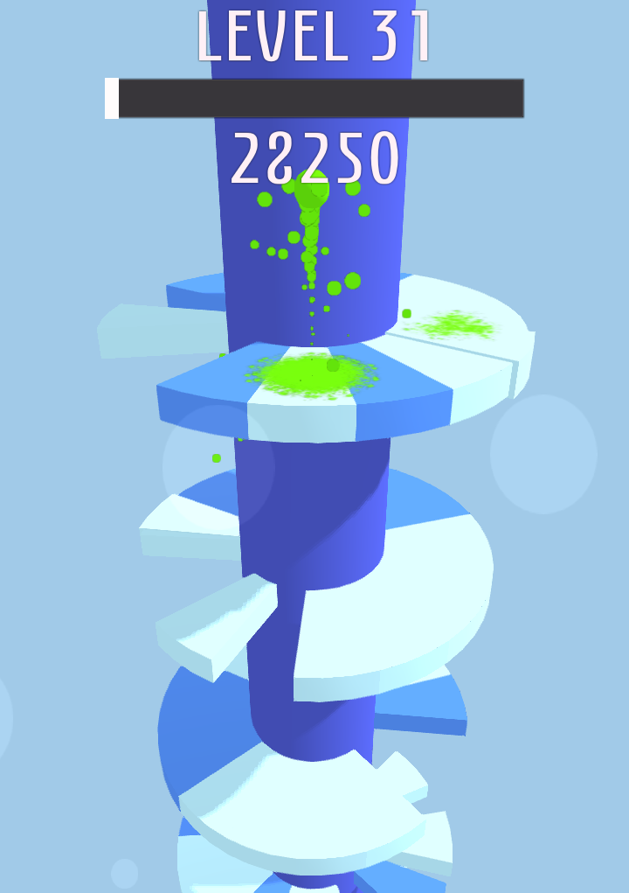

# TowerJumper

This is a clone of a popular android game in which you move a jumping ball and try to reach the end of a tower avoiding the obstacles. The levels are randomly generated.

## About this fork

This is a fork of [Dariasteam/TowerJumper](https://github.com/Dariasteam/TowerJumper) (GPL-3.0), originally made by Dariasteam.

- **Ported from Godot 2.x to Godot 4.4.** The old engine could only build 32-bit apps, which current Android versions complain about. This version builds as a 64-bit (`arm64-v8a`) app.
- **Palette fix ([issue #49](https://github.com/Dariasteam/TowerJumper/issues/49)).** In several color themes the deadly platforms had nearly the same color as the tower. The tower color of those themes was changed so deadly platforms are always clearly visible.
- Gameplay, level generation and physics were kept the same. Small differences: the power-up (it was never reachable in the old version) was removed, and a few particle effects look slightly different.
- The Android package name is `org.towerjumper.fork`, so it can be installed next to the original app.

## Building the Android app (no tools needed on your computer)

1. On GitHub open the **Actions** tab of your copy of this repository (the first time you may have to click "I understand my workflows, go ahead and enable them").
2. Choose **Build Android APK** on the left, then **Run workflow**.
3. After a few minutes a new entry appears under **Releases** (right side of the repository's front page). Open it on your phone and download `TowerJumper.apk`, then open the file to install it.

The workflow is in `.github/workflows/build-android.yml`. The first build creates a signing key and remembers it, so later builds can be installed on top of earlier ones.

## Running / editing on a computer

Open the folder with [Godot 4.4](https://godotengine.org/download/archive/4.4.1-stable/) (standard version, no .NET) and press play. Mouse dragging works like a finger.

# Contributing

## Adding new palettes

Palettes are stored in [`palette.json`](palette.json) in the "environment" array. Each entry is `[regular segment, bad segment, column]` as hex colors. Please keep the bad segment clearly different from the column (see the note about issue #49 above). The file must be strict JSON (no trailing commas).

# Credits:
Font: [Eunomia Regular](https://fonts.google.com/?query=eunomia) (CC-0)
